# 🌍 Quiz Game — Qt C++

A multi-category desktop quiz game built with **Qt (C++)**. Test your knowledge of flags, food, the World Cup, and Moroccan heritage through picture-based questions, with lifelines, an AI assistant, background anasheed, a bilingual interface (English / Arabic), and a player login with profile.

> **Version:** 1.0  
> **Author:** Ilyass Benhadi  
> **Framework:** Qt (C++) · CMake  
> **Total questions:** 1057 (stored in JSON)

---

## 📸 Screenshots

All screenshots are stored in the [`images_project/`](images_project/) folder.

| Main Menu | Game Categories | Game Modes |
|:---:|:---:|:---:|
| 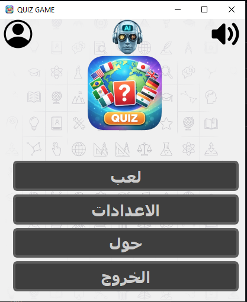 | 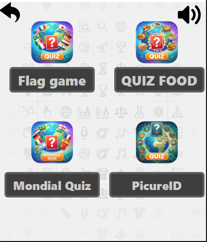 | 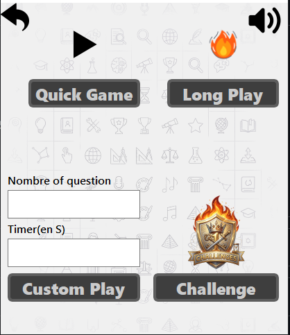 |

| In-game (Quick Game) | Reveal Answer | 50:50 Lifeline |
|:---:|:---:|:---:|
| 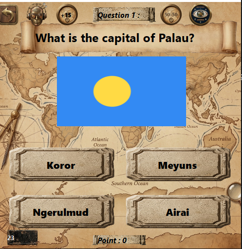 | 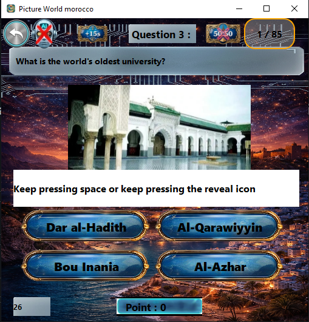 | 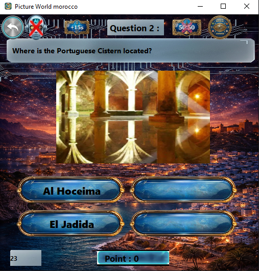 |

| AI Chat | Score Screen | Account |
|:---:|:---:|:---:|
| 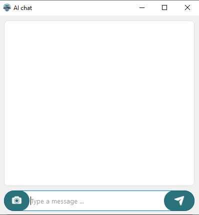 | 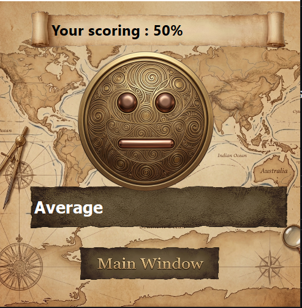 | 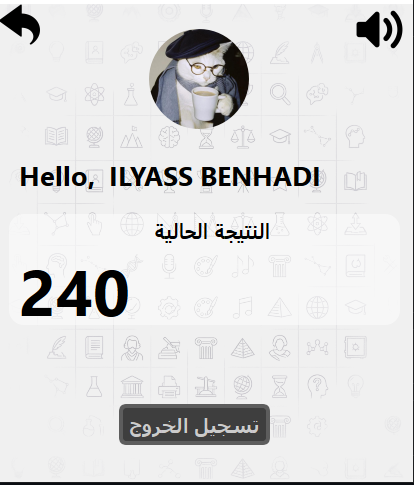 |

| Settings | Language | Sounds |
|:---:|:---:|:---:|
| 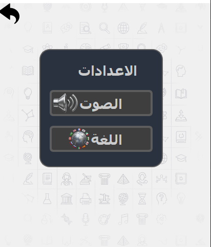 | 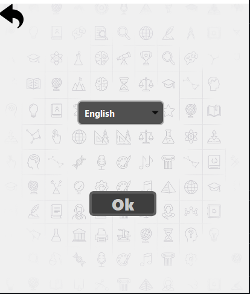 | 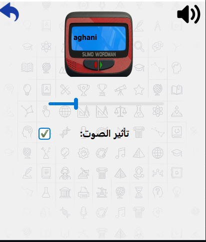 |

| About / Credits | AI Option |
|:---:|:---:|
| 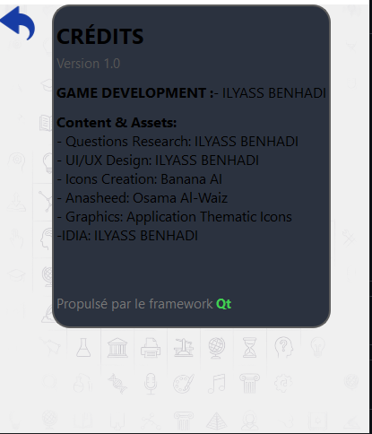 | 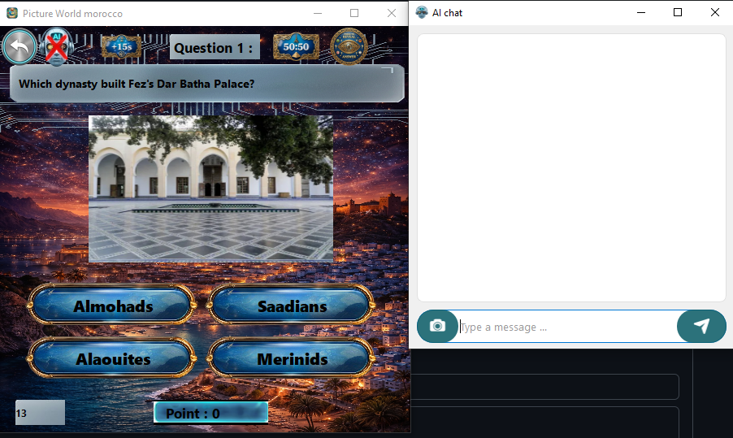 |

---

## ✨ Features

### 🎮 Quiz Categories
- **Flag Game** — identify countries by their flags and answer related geography questions (e.g. *What is the capital of Palau?*).
- **QUIZ FOOD** — questions about dishes and cuisines from around the world.
- **Mondial Quiz** — World Cup / football questions.
- **PictureID** — picture-based questions, including **Picture World Morocco** (e.g. *Which dynasty built Fez's Dar Batha Palace?*, *What is the world's oldest university?*).

### 🕹️ Game Modes
| Mode | Description |
|---|---|
| **Quick Game** | A fast round with a default number of questions. |
| **Long Play** | A longer session with many questions. |
| **Custom Play** | Choose your own **number of questions** and **timer (in seconds)**. |
| **Challenge** | A harder mode with a progress counter (e.g. `1 / 85`). |

### 🆘 Lifelines & Helpers
- **+15s** — add 15 extra seconds to the timer.
- **50:50** — removes two wrong answers.
- **Reveal Answer** (eye icon) — gradually reveals the answer (keep pressing the reveal icon or the **Space** key).
- **AI Assistant** (robot icon) — opens an **AI chat window** where you can type a message or attach an image (camera button) to get help with a question.

### 🔐 Login & Profile
- **Login system** to identify the player.
- **Account page** with avatar, greeting, **current total score**, and **logout**.
- Live **question counter**, **points**, and **countdown timer** during play.
- End-of-game **score screen** with a percentage and a rating message (e.g. *Average*).

### ⚙️ Settings
- **Sound:** volume slider and a toggle for sound effects.
- **Language:** **English** and **Arabic** (translation files `app_en.ts` / `app_ar.ts`), with right-to-left layout for Arabic.
- Global mute / sound button on most screens.

### 🎵 Audio
- Background **anasheed** (Islamic vocal music) with the current track name displayed in the sound settings.
- Sound effects for in-game interactions.

---

## 🗄️ Database (JSON)

Questions are stored in **JSON files** in the [`json/`](json/) folder and embedded in the app through `json.qrc`.

- **Total questions: 1057**
- Organized by category (Flags, Food, World Cup, PictureID / Morocco).
- Each question contains: the question text, four possible answers, the correct answer, and an optional image.

Example (structure may vary slightly from the real files):

```json
{
  "question": "What is the capital of Palau?",
  "image": ":/img/flags/palau.png",
  "answers": ["Koror", "Meyuns", "Ngerulmud", "Airai"],
  "correct": "Ngerulmud"
}
```

---

## 📁 Project Structure

```
.
├── images_project/      # Screenshots used in this README
├── img/                 # Images, icons, backgrounds used in the game
├── json/                # Questions database (1057 questions, JSON)
├── sounds/              # Anasheed and sound effects
├── build/               # Build output (can be deleted / regenerated)
├── CMakeLists.txt       # CMake build configuration
├── Ressource.qrc        # Images / icons resources
├── audio.qrc            # Audio resources
├── json.qrc             # JSON questions resources
├── app_en.ts            # English translation
├── app_ar.ts            # Arabic translation
├── main.cpp             # Entry point
├── mainwindow.*         # Main menu / login / settings
├── first_game.*         # Flag game
├── food_game.*          # Food quiz
├── world_cup.*          # Mondial (World Cup) quiz
├── picture_m.*          # Picture quiz (menu / mode)
├── picture_world.*      # Picture World Morocco quiz
├── aichat.*             # AI chat assistant
└── ta3lab.mp3           # Background anasheed
```

---

## 🛠️ Requirements

- **Qt 6.x** (Qt 5.15 may work with minor changes) — installed with the Qt Online Installer
- Qt modules: **Core, Gui, Widgets, Multimedia, Network, LinguistTools**
- **CMake 3.16+**
- A **C++17** compiler: MSVC 2019+ / MinGW 64-bit (Windows), GCC / Clang (Linux, macOS)
- **Qt Creator** (recommended)
- An **API key** for the AI chat feature (optional — see below)

---

## 🚀 Installation

### 1. Clone the repository
```bash
git clone https://github.com/<your-username>/<repo-name>.git
cd <repo-name>
```

### 2. Install Qt
1. Download the **Qt Online Installer** from [qt.io/download](https://www.qt.io/download-qt-installer).
2. Select a **Qt 6.x** kit for your compiler (e.g. *MinGW 64-bit* or *MSVC 2019 64-bit*), plus **Qt Creator** and **CMake**.
3. Make sure **Qt Multimedia** is checked in the additional libraries.

*Linux (Debian/Ubuntu) alternative:*
```bash
sudo apt install qt6-base-dev qt6-multimedia-dev qt6-tools-dev cmake build-essential
```

### 3. Configure the AI chat (optional)
The API key was removed from the source code for security. To enable the AI assistant:
1. Open `aichat.cpp`.
2. Replace the placeholder comment/value with **your own API key**.
3. Never commit your real key to GitHub.

Without a key, the rest of the game works normally.

### 4. Build and run

**Option A — Qt Creator (easiest)**
1. Open `CMakeLists.txt` in **Qt Creator**.
2. Select your Qt kit and click **Configure Project**.
3. Click **Build** 🔨 then **Run** ▶️.

### 5.NB 
If you want just to play the game just download it,this is the link without download qt : https://github.com/Ilyass-bn/QUIZ-GAME-CplusQt/releases/tag/v1.0.2
**Option B — Command line**
```bash
mkdir build-release && cd build-release
cmake .. -DCMAKE_BUILD_TYPE=Release
cmake --build . --config Release
./QuizGame        # on Windows: QuizGame.exe
```
> Use a fresh build folder (not the committed `build/` folder). If CMake can't find Qt, add `-DCMAKE_PREFIX_PATH=/path/to/Qt/6.x.x/<kit>`.

### 5. Deploy on Windows (optional)
To run the `.exe` on a PC without Qt installed:
```bash
windeployqt QuizGame.exe
```

---

## 🎯 How to Play

1. Launch the game and **log in**.
2. Press **Play** (لعب).
3. Choose a **category** (Flag game, Quiz Food, Mondial Quiz, PictureID).
4. Choose a **game mode** (Quick, Long, Custom, or Challenge).
5. Answer each question before the timer runs out.
6. Use lifelines (**+15s**, **50:50**, **Reveal**, **AI**) when you're stuck.
7. See your **score** at the end and return to the main window.

---

## 🙏 Credits

| Role | Name |
|---|---|
| **Game Development** | Ilyass Benhadi |
| **Questions Research** | Ilyass Benhadi |
| **UI/UX Design** | Ilyass Benhadi |
| **Icons Creation** | Banana AI |
| **Anasheed** | Osama Al-Waiz |
| **Graphics** | Application Thematic Icons |
| **Idea** | Ilyass Benhadi |

Powered by the **[Qt](https://www.qt.io/)** framework.

---

## 📄 License

Add a `LICENSE` file (e.g. MIT) to define how others may use this project.

> ⚠️ Anasheed and third-party assets remain the property of their respective owners.

---

## 📬 Contact

**Ilyass Benhadi** — Game developer  
Feel free to open an issue or submit a pull request to suggest improvements or new questions.
